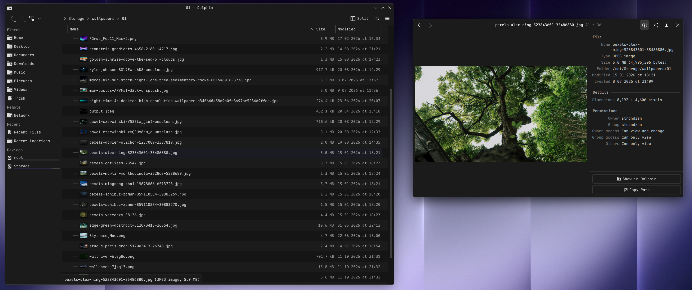

# KwikLook

KwikLook shows a quick preview of a file when you press Space in Dolphin, on KDE Plasma 6. Press Space or Esc again and it's gone; ← and → go through the folder.

It keeps running in the background, so previews open at once, and the preview window looks like your other windows: corners, outline, shadow and colours follow your Breeze and colour scheme settings. It shows pictures, text and code, PDFs and the details of any file, without starting a full application.

This is version 0.1.0 (see [CHANGELOG.md](CHANGELOG.md)). I mostly test it on my own machine (Arch Linux, Plasma 6 on Wayland, Dolphin 26.08), so other distributions and setups may need some work.

## Screenshots



## Features

- Press Space in Dolphin to preview the selected file; ← and → go through the folder in Dolphin's order and Dolphin's selection follows along.
- Pictures fill the preview window; small ones stay at their real size.
- Text and code files show with syntax colours and line numbers; long files show their beginning.
- PDFs show all their pages, fitted to the window.
- Any other file shows a large thumbnail (as in Dolphin) or its type's icon, with its type, size and when it was changed.
- An (i) panel with the file's details: name, type, size, dates, picture size and camera details, owner and permissions, plus “Show in Dolphin” and “Copy Path”.
- “Open with…” and Share buttons in the preview's bar.
- Preview files from the command line too: `kwiklook <files>`.

## Requirements

- KDE Plasma 6 with Dolphin.
- Qt 6.8 or newer, with Qt PDF (part of Qt WebEngine on Arch).
- KDE Frameworks 6.19 or newer, including Kirigami, KIO, Purpose, KFileMetaData and KSyntaxHighlighting.
- Kirigami Addons 1.0 or newer.

## Installation

### Arch Linux

There's no AUR package yet. The repository has a PKGBUILD that builds the release:

```sh
git clone https://github.com/strandzen/KwikLook.git
cd KwikLook/packaging/arch
makepkg -si
```

### Other distributions

These aren't tested yet. Install the build dependencies (see below), then:

```sh
cmake --preset release
cmake --build --preset release
sudo cmake --install build/release
```

<details>
<summary><strong>Build dependencies</strong></summary>

Arch:

```sh
sudo pacman -S --needed cmake extra-cmake-modules qt6-base qt6-declarative qt6-webengine \
    kconfig kcoreaddons ki18n kwindowsystem kio kservice purpose kfilemetadata \
    kirigami kirigami-addons syntax-highlighting
```

Other distributions: the development packages of CMake, Extra CMake Modules, Qt 6 (Base, Declarative, PDF) and the KDE Frameworks 6 listed above (Config, CoreAddons, I18n, WindowSystem, KIO, Service, Purpose, FileMetaData, Kirigami, SyntaxHighlighting), plus Kirigami Addons. Package names differ between distributions.

</details>

After installing, close every Dolphin window (or log out and back in) so Dolphin picks up KwikLook.

## Usage

- In Dolphin, select a file and press Space. The preview opens; Dolphin's selection follows it as you go through the folder.
- Drag the preview's bar to move the window, drag an edge or corner to resize it.
- (i) shows the file's details; “Open with…” opens the file in another application and closes the preview.

### Keys

| Key | What it does |
|---|---|
| Space (in Dolphin) | Opens the preview of the selected file (the key can be changed in the settings) |
| Space or Esc | Closes the preview |
| ← and → | Previous and next file |

Space keeps working as usual in Dolphin's location bar, while renaming, in type-ahead search and in selection mode, and on folders.

### From the command line

| Command | What it does |
|---|---|
| `kwiklook <files>` | Shows a preview of the files; ← and → go between them, Space or Esc closes it |
| `kwiklook --settings` | Opens the settings window |
| `kwiklook --quit` | Stops KwikLook running in the background |

## Settings

Open “KwikLook Settings” from the app launcher (or run `kwiklook --settings`):

- **Corners:** like your Breeze window decoration, or a radius of your choice.
- **Open key:** the key that opens the preview in Dolphin: Space, Shift+Space or Ctrl+Space.
- **Close when you switch to another window:** on by default.
- **Start in the background at login:** off by default. KwikLook starts with Dolphin anyway; this makes the very first preview after login open faster.

## Security

A preview reads the file, so a file made to attack a bug in a picture, PDF or other file reader could do harm when you preview it. What KwikLook does about that:

- **Not sandboxed:** pictures, PDFs, text and file details are read inside KwikLook itself, with the same rights as you; thumbnails come from KDE's thumbnail service, also unsandboxed. Dolphin already reads the same files the same way when it shows thumbnails or indexes files for search, whether you preview them or not. The protection here is keeping your system up to date.
- **Sandboxed:** external programs KwikLook runs on a file are locked in a sandbox: no network, no access to anything but that one file, and they can only write to KwikLook's cache. Version 0.1.0 runs no external programs yet; this applies to office documents (through LibreOffice) and anything similar added later.

## Troubleshooting

**Space does nothing in Dolphin.** Close all Dolphin windows and open Dolphin again: it only picks up KwikLook when it starts. Also check the open key in the settings.

**Space previews only one file and ← → don't go through the folder.** KwikLook reads Dolphin's file list through Dolphin's internals, which a Dolphin update can change. Please report it with your Dolphin version.

**Ctrl+Space no longer toggles the selection in Dolphin.** With Ctrl+Space as the open key, KwikLook takes it over. Choose another open key to get Dolphin's back.

**I want to turn off the Dolphin part for a moment.** Start Dolphin with `KWIKLOOK_DISABLE_DOLPHIN_HOOK=1 dolphin`.

Bugs and ideas are welcome in the [issue tracker](https://github.com/strandzen/KwikLook/issues).

## Uninstall

Turn off “Start in the background at login” first if you turned it on, then run `kwiklook --quit` and remove the package (`sudo pacman -R kwiklook`), or, if you installed with CMake, run `sudo xargs rm < build/release/install_manifest.txt` in the source folder.

Left behind in your home folder: the settings in `~/.config/kwiklookrc` and the window state in `~/.local/state/kwiklookstaterc`. Delete them if you like.

## Translations

KwikLook is in English only for now. Translations are welcome: [po/Messages.sh](po/Messages.sh) extracts the strings to translate.

## Credits

The Dolphin integration (pressing Space in Dolphin, following its file order and selection) is based on [KDEGlance](https://github.com/AlexGraveler/KDEGlance) by AlexGraveler and the KDEGlance contributors, used under the GPL-3.0-or-later. Thank you!

## License

GPL-3.0-or-later, see [LICENSE](LICENSE).
