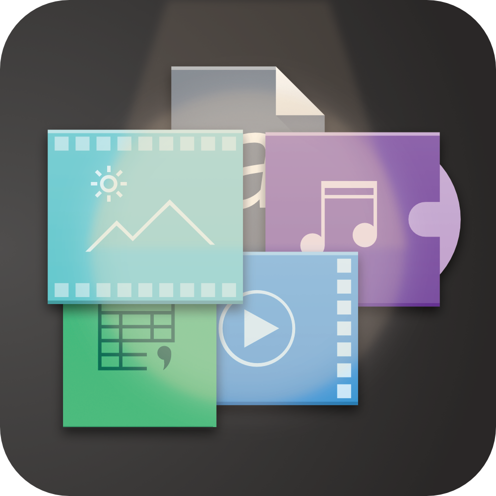

<div align="center">
    
    <h1><b>KwikLook</b></h1>
</div>

KwikLook shows a quick preview of a file when you press Space in Dolphin, on KDE Plasma 6. Press Space or Esc again and it's gone; ← and → or ↓ and ↑ to go through the folder.

It keeps running in the background, so previews open at once. It shows pictures, text and code, Markdown and web pages, PDFs, office documents, videos and audio, fonts, tables, contacts and calendar events, and the details of any file, without starting a full application. The preview window fits in with Plasma: its corners, outline and shadow follow your Breeze window decoration settings, and its buttons, colours and fonts follow your application style and colour scheme.

This is version 0.8.1 (see [CHANGELOG.md](CHANGELOG.md)). I mostly test it on my own machine (Arch Linux, Plasma 6 on Wayland, Dolphin 26.08), so other distributions and setups may need some work.

## Demo
https://github.com/user-attachments/assets/9a19e870-607a-4d3a-9edf-fbefe5b36bce


## Features

- Press Space in Dolphin to preview the selected file; ← and → go through the folder in Dolphin's order and Dolphin's selection follows along, and the corner shows where you are for a moment (“2 / 5”). With several files selected, the preview goes through just those. Enter opens the file in its usual application.
- The files next to the one you're looking at are prepared in the background, so going to the next picture is instant, even for large photos.
- An index sheet shows all the files as thumbnails to pick one from (Ctrl+Enter).
- Pictures give the preview window their shape, centred, and fill it edge to edge: as large as the picture, or up to most of the screen; going to the next picture reshapes it. Small pictures stay at their real size, so they don't get blurry; vector pictures (SVG) always fill the window and stay sharp. Animated GIFs and WebPs play. Camera RAW photos (DNG, CR2, NEF, ARW and more) show like any other picture.
- The preview opens centred on the screen, centred on the Dolphin window or at the mouse pointer, as you choose.
- Text and code files show with syntax colours and line numbers; long files show their beginning. Find with Ctrl+F, also in PDFs.
- Markdown, HTML, JSON, SVG and .desktop files show formatted, and one button in the bar switches to their source. Nothing is ever loaded from the internet.
- CSV and TSV files show as a table; contacts (.vcf) and calendar files (.ics) as cards (with KContacts and KCalendarCore installed).
- PDFs show all their pages, fitted to the window, with a sidebar of small pages and their contents (bookmarks); the section you're reading is marked. Markdown and HTML files list their headings there too.
- Archives (zip, 7z, tar, RAR, ISO and more) show what's inside as folders you can open, with sizes and dates, without unpacking anything. Password-protected ones are marked.
- Office documents (Word, Excel, PowerPoint and OpenDocument files) show like PDFs, when LibreOffice is installed.
- EPUB books show their cover, title and author, then the chapters as text you can scroll, search and zoom, with the book's table of contents in the sidebar. Very long books show their beginning.
- Videos and audio play, with the usual controls, volume, repeat and full screen; audio shows its cover, title and artist.
- Fonts show their alphabet and a sample in the font itself, at a size you choose, or your own text; “Install Font” installs one for you.
- Zoom pictures, text and PDFs; pictures zoom towards the mouse pointer and can be dragged around.
- Any other file shows a large thumbnail (as in Dolphin) or its type's icon, with its type, size and when it was changed.
- AppImages get an “Install with AppImage Manager” button, when AppImage Manager is installed.
- An (i) panel with the file's details: name, type, size, dates, picture size and camera details, owner and permissions, plus “Show in Dolphin” and “Copy Path”.
- “Open with…” and Share buttons in the preview's bar. For pictures, “Open with…” also offers Spectacle's editor, to draw on them or add text. Share also offers LocalSend, when it's installed.
- Choose the bar's buttons and their order in the settings, by dragging them.
- Preview files from the command line too: `kwiklook <files>`.

## Requirements

- KDE Plasma 6 on Wayland, with Dolphin. X11 sessions aren't supported.
- Qt 6.8 or newer, with Qt PDF (part of Qt WebEngine on Arch) and Qt Multimedia with its FFmpeg backend.
- KDE Frameworks 6.19 or newer, including Kirigami, KIO, Purpose, KFileMetaData, KSyntaxHighlighting and KCrash, and KDE's style for Qt Quick (qqc2-desktop-style, part of every Plasma desktop).
- Kirigami Addons 1.0 or newer.
- libarchive, to list what's inside archives.
- libseccomp, and a recent Linux kernel for the sandbox around office previews, archive listings and books (Landlock with its newer rules for local sockets). If the kernel is too old, office documents, archives and books just show their details and a note says why.
- Optional: LibreOffice, for previews of office documents.
- Optional: KDE's image plugins (KImageFormats, with LibRaw), for camera RAW photos and formats like AVIF, HEIC and JPEG XL.
- Optional: KContacts and KCalendarCore, to show contacts (.vcf) and calendar files (.ics) as cards. Without them those files show as text. They are needed when building, for the cards to be included.

## Installation

### Arch Linux

KwikLook is in the AUR as [kwiklook](https://aur.archlinux.org/packages/kwiklook). With an AUR helper:

```sh
yay -S kwiklook
```

(or `paru -S kwiklook`). Without one:

```sh
git clone https://aur.archlinux.org/kwiklook.git
cd kwiklook
makepkg -si
```

### Other distributions

These aren't tested yet. Install the build dependencies (see below), then:

```sh
cmake --preset release
cmake --build --preset release
sudo cmake --install build/release
```

<details>
<summary><strong>Build dependencies</strong></summary>

Arch:

```sh
sudo pacman -S --needed cmake extra-cmake-modules qt6-base qt6-declarative qt6-webengine qt6-multimedia qt6-multimedia-ffmpeg \
    kconfig kcoreaddons kcrash ki18n kwindowsystem kio kservice purpose kfilemetadata qqc2-desktop-style \
    kirigami kirigami-addons syntax-highlighting kcontacts kcalendarcore libarchive libseccomp
```

Other distributions: the development packages of CMake, Extra CMake Modules, Qt 6 (Base, Declarative, PDF, Multimedia) and the KDE Frameworks 6 listed above (Config, CoreAddons, Crash, I18n, WindowSystem, KIO, Service, Purpose, FileMetaData, Kirigami, SyntaxHighlighting; Contacts and CalendarCore for the cards), plus Kirigami Addons, libarchive and libseccomp. Package names differ between distributions.

</details>

After installing, close every Dolphin window (or log out and back in) so Dolphin picks up KwikLook.

## Usage

- In Dolphin, select a file and press Space. The preview opens; Dolphin's selection follows it as you go through the folder.
- Drag the preview's bar to move the window, drag an edge or corner to resize it. A size you set yourself stays until the preview closes; pictures then fit into it.
- (i) shows the file's details; “Open with…” opens the file in another application and closes the preview.
- To edit a picture or a video, use “Open with…”: for pictures it offers Spectacle's editor.

### Keys

| Key | What it does |
|---|---|
| Space (in Dolphin) | Opens the preview of the selected file (the key can be changed in the settings) |
| Space or Esc | Closes the preview (Esc first closes the search, the index sheet or full screen) |
| Enter | Opens the file in its usual application and closes the preview |
| ← and →, ↑ and ↓ | Previous and next file |
| Ctrl+Enter | Index sheet: all files as thumbnails |
| Ctrl+F, F3 and Shift+F3 | Find in text and PDFs, next and previous match |
| Ctrl+wheel, Ctrl++ and Ctrl+- | Zoom in and out (pictures also with a touchpad pinch) |
| Ctrl+0 | Back to the normal size |
| Double-click a picture | Real size, and back to fitted |
| Media keys, or a click on a video | Play and pause |
| F, or double-click a video | Full screen, and back |

Space keeps working as usual in Dolphin's location bar, while renaming, in type-ahead search and in selection mode, and on folders.

### From the command line

| Command | What it does |
|---|---|
| `kwiklook <files>` | Shows a preview of the files; ← and → go between them, Space or Esc closes it |
| `kwiklook --settings` | Opens the settings window |
| `kwiklook --quit` | Stops KwikLook running in the background |

## Settings

Open “KwikLook Settings” from the app launcher (or run `kwiklook --settings`):

- **Corners:** like your Breeze window decoration, or a radius of your choice.
- **Bar:** which buttons the preview's bar shows and in what order; drag them in, along or out.
- **Open key:** the key that opens the preview in Dolphin: Space, Shift+Space or Ctrl+Space.
- **Open the preview:** centred on the screen (the default), centred on Dolphin, at the mouse pointer, or where the window manager puts it. For all but the last, KwikLook places its window and gives it the pictures' shape through a small KWin script that it loads while it runs and removes when it stops; nothing is installed into KWin and none of its settings change.
- **Close when you switch to another window:** on by default.
- **Start in the background at login:** off by default. KwikLook starts with Dolphin anyway; this makes the very first preview after login open faster.
- **Free memory when KwikLook isn't used for a while:** on by default. After 15 minutes without a preview, KwikLook starts afresh in the background and uses about a third of the memory; the next preview then opens a moment later (about a tenth of a second).
- **Start playing when a video or song opens:** on by default.
- **Start without sound:** off by default.
- **Preview office documents:** on by default, when LibreOffice is installed.

## Security

A preview reads the file, so a file made to attack a bug in a picture, PDF or other file reader could do harm when you preview it. What KwikLook does about that:

- **Not sandboxed:** pictures, PDFs, text and file details are read inside KwikLook itself, with the same rights as you; thumbnails come from KDE's thumbnail service, also unsandboxed. Dolphin already reads the same files the same way when it shows thumbnails or indexes files for search, whether you preview them or not. The protection here is keeping your system up to date.
- **Sandboxed:** external programs KwikLook runs on a file are locked in a sandbox: no network, no connection to other programs, read access only to that one file (plus the system's programs and fonts), and they can only write to a scratch folder in KwikLook's cache. In `/tmp` they may only create and remove entries, because LibreOffice puts its own connection there. This applies to office documents, which LibreOffice turns into PDFs, to archives, which a small helper lists, to books, whose files the same helper unpacks into memory, and anything similar added later. The PDF it makes is then shown like any PDF, unsandboxed.
- **No sandbox, no conversion:** on systems whose kernel can't lock these programs in this way, office documents aren't converted, archives aren't listed and books aren't shown (the preview says so).

## Troubleshooting

**Space does nothing in Dolphin.** Close all Dolphin windows and open Dolphin again: it only picks up KwikLook when it starts. Also check the open key in the settings.

**Space previews only one file and ← → don't go through the folder.** KwikLook reads Dolphin's file list through Dolphin's internals, which a Dolphin update can change. Please report it with your Dolphin version.

**Ctrl+Space no longer toggles the selection in Dolphin.** With Ctrl+Space as the open key, KwikLook takes it over. Choose another open key to get Dolphin's back.

**The preview's corners and shadow don't match my other windows.** The preview draws its own frame, made to look like the Breeze window decoration (it follows Breeze's settings). With another window decoration (Oxygen, Klassy, an Aurorae theme) it still looks like Breeze. Buttons, colours, fonts and icons always follow your Application Style and colour scheme.

**Office documents show only their icon and a note.** “LibreOffice couldn't convert this document”: the file may be damaged or password-protected. “This system can't run LibreOffice shut away…”: your kernel is too old for the sandbox, so KwikLook doesn't run LibreOffice at all. No note: check that LibreOffice is installed and “Preview office documents” is on in the settings.

**The preview jumps to another place or size a moment after it opens.** Another KWin script that remembers window positions (such as Remember Window Positions) puts it back where it was last time, in the last picture's shape. Add KwikLook (`io.github.strandzen.KwikLook`) to that script's blacklist (in Remember Window Positions the blacklist only counts when it restores “All except blacklisted apps”; with “All apps” it is ignored), or set “Open the preview” to “Where the window manager puts it”.

**The preview doesn't open where the setting says, and pictures don't shape the window.** This needs KWin, Plasma's window manager, with scripts allowed. A tiling script (such as Material Tiling, which some distributions turn on) sets every window's size itself: turn it off in System Settings → Window Management → KWin Scripts, or exclude KwikLook there if the script offers that. Elsewhere the preview opens where the window manager puts it and pictures fit into the window as it is.

**I want to turn off the Dolphin part for a moment.** Start Dolphin with `KWIKLOOK_DISABLE_DOLPHIN_HOOK=1 dolphin`.

Bugs and ideas are welcome in the [issue tracker](https://github.com/strandzen/KwikLook/issues).

**KwikLook crashed.** If KDE's crash dialog appears, its report has what's needed: open an issue at https://github.com/strandzen/KwikLook/issues and paste it. Without the dialog, `coredumpctl info kwiklook` in a terminal shows the last crash; paste its output. Say what kind of file was being previewed.

## Uninstall

Turn off “Start in the background at login” first if you turned it on, then run `kwiklook --quit` and remove the package (`sudo pacman -R kwiklook`), or, if you installed with CMake, run `sudo xargs rm < build/release/install_manifest.txt` in the source folder.

Left behind in your home folder: the settings in `~/.config/kwiklookrc`, the window state in `~/.local/state/kwiklookstaterc` and office previews in `~/.cache/kwiklook` (at most 200 MB). Fonts you installed from the preview stay in `~/.local/share/fonts`. Delete them if you like.

## Translations

KwikLook is in English only for now. Translations are welcome: [po/Messages.sh](po/Messages.sh) extracts the strings to translate.

## Credits

The Dolphin integration (pressing Space in Dolphin, following its file order and selection) is based on [KDEGlance](https://github.com/AlexGraveler/KDEGlance) by AlexGraveler and the KDEGlance contributors, used under the GPL-3.0-or-later. Thank you!

## License

GPL-3.0-or-later, see [LICENSE](LICENSE).
